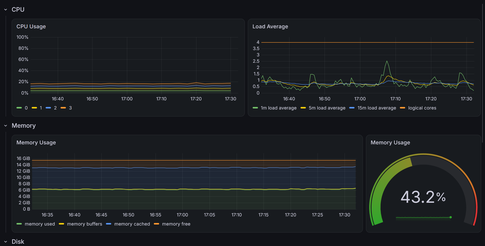
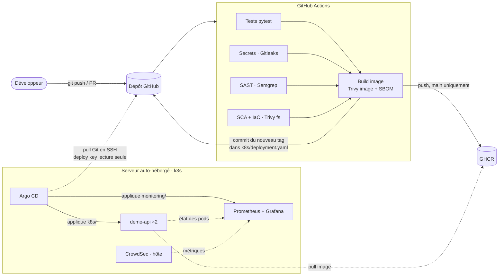

# Plateforme DevSecOps sécurisée

[](https://github.com/CubicPotato/devsecops-platform/actions/workflows/devsecops.yml)


<p align="center">
  
</p>

Chaîne CI/CD complète qui **teste, analyse et déploie** automatiquement une API Python conteneurisée sur un cluster **Kubernetes (k3s) auto-hébergé**, en **GitOps** avec **Argo CD**.

Chaque `git push` passe par quatre contrôles de sécurité (secrets, code, dépendances, configuration) puis par un scan de l'image. **Si une faille grave est détectée, rien n'est déployé.** Quand tout est vert, le cluster se met à jour tout seul en quelques minutes, sans que GitHub n'ait jamais accès au serveur.

> L'application (une petite API FastAPI) est volontairement simple : le sujet du projet, c'est la chaîne sécurisée qui l'entoure.

## En bref

|---|---|
| **Ce que fait le projet** | Du commit au déploiement en production, sans intervention manuelle, avec un *security gate* qui bloque les failles |
| **Sécurité** | Shift-left (Gitleaks, Semgrep, Trivy), image durcie, Pod Security `restricted`, GitOps en modèle *pull*, moindre privilège partout |
| **Infrastructure** | Serveur Debian personnel, k3s mono-nœud, Argo CD, pare-feu ufw + CrowdSec |
| **Observabilité** | Prometheus + Grafana (cluster, nœud, Argo CD, attaques bloquées par CrowdSec), déployés eux aussi en GitOps |
| **Stack** | Python · FastAPI · Docker · GitHub Actions · GHCR · Kubernetes (k3s) · Argo CD · Prometheus · Grafana |


## Architecture



Les flèches en pointillés partent **du serveur**. Le pipeline ne se connecte jamais au cluster : il se contente d'écrire le nouveau tag d'image dans Git, et Argo CD vient le chercher. Aucun identifiant du cluster n'est stocké dans GitHub et aucun port entrant n'est ouvert sur Internet.

## Le pipeline

```
 git push
    │
    ├── Tests unitaires (pytest)
    ├── Secrets ........ Gitleaks (tout l'historique git)
    ├── SAST ........... Semgrep (Python, OWASP Top 10, Dockerfile, GitHub Actions)
    └── SCA / IaC ...... Trivy fs (CVE des dépendances, misconfig Dockerfile + manifests K8s)
            │
            ▼  security gate : les 4 jobs doivent réussir
    Build de l'image ─► Trivy image (CVE de l'OS et des paquets) ─► SBOM CycloneDX
            │
            ▼  uniquement sur main
    Push vers GHCR (tag = SHA du commit)
            │
            ▼
    Commit du nouveau tag dans k8s/deployment.yaml
            │
            ▼  le cluster tire les changements
    Argo CD synchronise le cluster avec Git
```

Tous les résultats sont publiés au format SARIF dans l'onglet **Security → Code scanning** du dépôt. Le SBOM est archivé avec chaque exécution.

## Mesures de sécurité

| Domaine | Mesure |
|---|---|
| Pipeline | Permissions minimales par job (`permissions: {}` par défaut), actions tierces épinglées par **SHA** et non par tag, Dependabot pour les mettre à jour |
| Secrets | Aucun secret longue durée : `GITHUB_TOKEN` éphémère pour GHCR et le commit de déploiement, aucun accès au cluster stocké dans GitHub ; Gitleaks sur tout l'historique |
| Code | Semgrep (SAST), validation des entrées avec Pydantic |
| Dépendances | Trivy fs, versions épinglées, Dependabot avec un **délai de 7 jours** avant de proposer une nouvelle version |
| Image | Multi-stage, base `slim`, utilisateur non-root, `pip` retiré de l'image finale, scan Trivy, SBOM |
| Kubernetes | Pod Security `restricted`, `readOnlyRootFilesystem`, toutes les capabilities supprimées, pas de token de service account, limites CPU/RAM, NetworkPolicy |
| Déploiement | GitOps avec Argo CD (modèle *pull*), `selfHeal` qui annule toute modification manuelle du cluster, deploy key **en lecture seule** limitée à ce dépôt, environnement GitHub `production` (validation manuelle possible) |
| Serveur | Pare-feu ufw en refus par défaut, **API Kubernetes (6443), Argo CD et Grafana non exposés** (accès par tunnel SSH), CrowdSec avec bouncer nftables, SSH par clé uniquement |
| Observabilité | Métriques du nœud, des pods, d'Argo CD et de CrowdSec dans Grafana ; chart Helm et dashboards à **version figée** (tag ou SHA) ; identifiants Grafana dans un Secret créé hors de Git |

## Choix techniques

- **GitOps en *pull* plutôt qu'un `kubectl apply` depuis la CI.** Pousser depuis GitHub Actions obligerait à exposer l'API Kubernetes et à stocker un kubeconfig dans GitHub. Avec Argo CD, c'est le cluster qui va lire Git : la surface d'attaque côté CI disparaît, et Git devient la seule source de vérité.
- **Actions épinglées par SHA.** Un tag peut être déplacé vers du code malveillant par quiconque compromet le dépôt de l'action ; un SHA de commit, non. Dependabot garde les SHA à jour.
- **Délai de 7 jours sur Dependabot.** Une version publiée il y a quelques heures peut être un paquet piégé (attaque de la chaîne d'approvisionnement). Attendre une semaine laisse le temps à l'écosystème de le détecter et de le retirer.
- **Security gate sur HIGH/CRITICAL avec `ignore-unfixed`.** Le pipeline bloque les failles graves pour lesquelles un correctif existe. Bloquer sur des CVE sans correctif empêcherait tout déploiement sans rien rendre plus sûr ; elles restent visibles dans l'onglet Security.
- **Deploy key sur un dépôt public.** Argo CD pourrait lire le dépôt sans identifiant. La deploy key (SSH, lecture seule, limitée à ce dépôt, révocable depuis GitHub) applique quand même le principe d'un accès dédié et minimal, et permet de repasser le dépôt en privé sans rien changer côté cluster.
- **k3s sans Traefik.** Pour une seule application, le ServiceLB intégré à k3s expose directement le port 80 : un Ingress n'apporterait que de la complexité (il reste une piste d'amélioration avec HTTPS).
- **Le monitoring aussi en GitOps.** La stack Prometheus/Grafana est une Application Argo CD comme les autres : le chart Helm officiel à version figée, et les valeurs dans ce dépôt. Une montée de version est un commit relu, pas une commande lancée à la main sur le serveur.

## Structure

```
app/                     API FastAPI
tests/                   tests pytest
Dockerfile               image durcie (multi-stage, non-root)
k8s/                     manifests Kubernetes, synchronisés par Argo CD
argocd/                  applications Argo CD (demo-api, monitoring)
monitoring/              valeurs du chart kube-prometheus-stack + manifests complémentaires
.github/workflows/       pipeline DevSecOps
.github/dependabot.yml   mises à jour automatiques
```

## Lancer en local

```bash
python -m venv .venv && source .venv/bin/activate
pip install -r requirements-dev.txt
pytest -v
uvicorn app.main:app --reload        # http://127.0.0.1:8000/docs

docker build -t demo-api .
docker run -p 8000:8000 demo-api
```

Lancer les scans en local (facultatif) :

```bash
semgrep scan --config p/python --config p/owasp-top-ten --config p/dockerfile
trivy fs --scanners vuln,misconfig,secret .
trivy image demo-api
```

## Démo : le pipeline bloque une faille

Sur une branche `demo/vuln`, ajouter par exemple dans `app/main.py` :

```python
import subprocess

@app.get("/ping")
def ping(host: str):
    return subprocess.run(f"ping -c 1 {host}", shell=True, capture_output=True).stdout
```

puis ouvrir une Pull Request : **Semgrep** signale l'injection de commande et le pipeline échoue. Même chose avec une vieille version d'une bibliothèque dans `requirements.txt` (détectée par **Trivy**) ou une fausse clé AWS dans un fichier (détectée par **Gitleaks**). Une fois la faille corrigée et poussée, le pipeline repasse au vert.

## Reproduire l'infrastructure

Prérequis : un serveur **Debian** accessible en SSH, avec au moins 2 vCPU et 4 Go de RAM.

### 1. Installer k3s

Sur le serveur. Le script est téléchargé puis relu avant d'être exécuté, plutôt que lancé avec `curl | sh` :

```bash
curl -sfL https://get.k3s.io -o /tmp/k3s-install.sh
less /tmp/k3s-install.sh

# Traefik est désactivé : le service demo-api utilise directement le port 80
sudo sh /tmp/k3s-install.sh --disable traefik

# Utiliser kubectl sans sudo
mkdir -p ~/.kube
sudo cp /etc/rancher/k3s/k3s.yaml ~/.kube/config
sudo chown "$USER": ~/.kube/config
chmod 600 ~/.kube/config
echo 'export KUBECONFIG=~/.kube/config' >> ~/.bashrc
export KUBECONFIG=~/.kube/config

kubectl get nodes   # le nœud doit être "Ready"
```

Si `ufw` est actif, autoriser le port 80 et les réseaux internes de k3s (pods et services). Le port 6443 de l'API Kubernetes reste fermé :

```bash
sudo ufw allow 80/tcp
sudo ufw allow from 10.42.0.0/16
sudo ufw allow from 10.43.0.0/16
```

Facultatif : [CrowdSec](https://docs.crowdsec.net/) avec le bouncer `crowdsec-firewall-bouncer-nftables` pour bannir automatiquement les IP malveillantes.

### 2. Configurer le dépôt GitHub

1. **Settings → Environments → New environment** : `production`. On peut y ajouter des *Required reviewers* pour valider chaque déploiement à la main.
2. **Settings → Code security** : activer *Dependabot alerts* et *Code scanning*. Sur un dépôt **privé**, l'onglet Security demande GitHub Advanced Security.
3. Si la branche `main` est protégée, le job de déploiement doit pouvoir y pousser son commit, sinon il échoue.

### 3. Premier passage du pipeline

Pousser sur `main`. Le pipeline construit et analyse l'image, la pousse sur GHCR, puis commite son tag dans `k8s/deployment.yaml` (faire `git pull` ensuite).

L'image GHCR est **privée** par défaut, et le cluster ne pourrait pas la télécharger (`ImagePullBackOff`). La rendre publique : **profil → Packages → le package → Package settings → Change visibility → Public**.

### 4. Installer Argo CD

Sur le serveur :

```bash
# Version figée : la dernière publiée au moment de l'installation
ARGOCD_VERSION=$(curl -s https://api.github.com/repos/argoproj/argo-cd/releases/latest | grep -oP '"tag_name": "\K[^"]+')
echo "$ARGOCD_VERSION"

kubectl create namespace argocd
kubectl apply -n argocd --server-side --force-conflicts \
  -f "https://raw.githubusercontent.com/argoproj/argo-cd/${ARGOCD_VERSION}/manifests/install.yaml"
kubectl -n argocd rollout status deployment/argocd-server
```

Le service `argocd-server` reste en `ClusterIP` : il n'est pas exposé.

### 5. Donner à Argo CD un accès en lecture au dépôt

Argo CD lit le dépôt en SSH avec une **deploy key en lecture seule**. La clé privée est générée en RAM, chargée dans un Secret Kubernetes, puis effacée :

```bash
umask 077; K=$(mktemp -d /dev/shm/argocd-key.XXXXXX)
ssh-keygen -q -t ed25519 -N "" -C "argocd deploy key (read-only)" -f "$K/key"
kubectl -n argocd create secret generic repo-devsecops-platform \
  --from-literal=type=git \
  --from-literal=url=git@github.com:CubicPotato/devsecops-platform.git \
  --from-file=sshPrivateKey="$K/key"
kubectl -n argocd label secret repo-devsecops-platform argocd.argoproj.io/secret-type=repository
cat "$K/key.pub"; shred -u "$K/key"; rm -rf "$K"
```

Coller la clé publique affichée dans **Settings → Deploy keys → Add deploy key**, sans cocher *Allow write access*. Puis créer l'application :

```bash
# Argo CD suit désormais le dossier k8s/ de la branche main
kubectl apply -f https://raw.githubusercontent.com/CubicPotato/devsecops-platform/main/argocd/application.yaml
```

### 6. Vérifier

```bash
kubectl -n argocd get applications        # demo-api : Synced / Healthy
kubectl -n devsecops-demo get pods,svc
curl http://<IP_DU_SERVEUR>/health        # {"status":"ok"}
```

L'API est accessible depuis le réseau local sur `http://<IP_DU_SERVEUR>/` (documentation interactive sur `/docs`).

### Interface Argo CD

Depuis son PC, ouvrir un tunnel SSH qui lance le port-forward sur le serveur :

```bash
ssh -t -L 8080:localhost:8080 <utilisateur>@<IP_DU_SERVEUR> \
  'kubectl --kubeconfig ~/.kube/config -n argocd port-forward svc/argocd-server 8080:443'
```

Ouvrir `https://localhost:8080` (certificat auto-signé), utilisateur `admin`. Le mot de passe initial s'affiche sur le serveur avec :

```bash
kubectl -n argocd get secret argocd-initial-admin-secret -o jsonpath='{.data.password}' | base64 -d; echo
```

Le changer dès la première connexion (*User Info → Update password*), puis supprimer le secret initial, qui le contient en clair :

```bash
kubectl -n argocd delete secret argocd-initial-admin-secret
```

### 7. Monitoring (Prometheus + Grafana)

Créer le namespace et le Secret des identifiants Grafana. Le mot de passe est saisi sans écho et ne passe ni par Git ni par l'historique du shell :

```bash
kubectl create namespace monitoring
read -rsp "Mot de passe Grafana : " P; echo
printf %s "$P" | kubectl -n monitoring create secret generic grafana-admin \
  --from-literal=admin-user=admin --from-file=admin-password=/dev/stdin
unset P
```

Pour les dashboards CrowdSec, les métriques de CrowdSec doivent être joignables depuis les pods. En root, dans `/etc/crowdsec/config.yaml`, passer `prometheus.listen_addr` de `127.0.0.1` à `0.0.0.0`, puis `systemctl restart crowdsec`. Le port 6060 reste fermé au réseau local par ufw (seuls les réseaux de k3s sont autorisés).

Puis créer l'application :

```bash
kubectl apply -f https://raw.githubusercontent.com/CubicPotato/devsecops-platform/main/argocd/monitoring.yaml
kubectl -n argocd get applications        # monitoring : Synced / Healthy
```

Accès à Grafana par tunnel SSH, puis `http://localhost:3000` :

```bash
ssh -t -L 3000:localhost:3000 <utilisateur>@<IP_DU_SERVEUR> \
  'kubectl --kubeconfig ~/.kube/config -n monitoring port-forward svc/kps-grafana 3000:80'
```

Dashboards utiles : *Kubernetes / Compute Resources / Cluster*, *Node Exporter / Nodes*, *Argo CD* et *CrowdSec Overview*.

### Désinstaller

```bash
/usr/local/bin/k3s-uninstall.sh   # supprime k3s, Argo CD et l'application
```

## Pistes d'amélioration

- Signature de l'image avec **Cosign** et vérification à l'admission (Kyverno)
- **DAST** avec OWASP ZAP sur l'application déployée
- Secrets applicatifs chiffrés dans Git avec **Sealed Secrets** (ou External Secrets)
- Accès depuis Internet sans ouvrir de port, via **Cloudflare Tunnel**
- Ingress HTTPS (cert-manager + Let's Encrypt)
- Chiffrement des Secrets Kubernetes au repos (`--secrets-encryption` de k3s)
